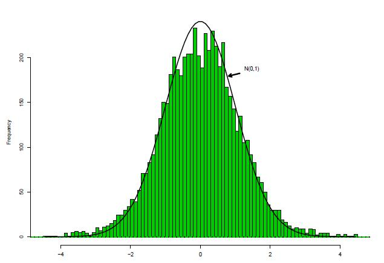
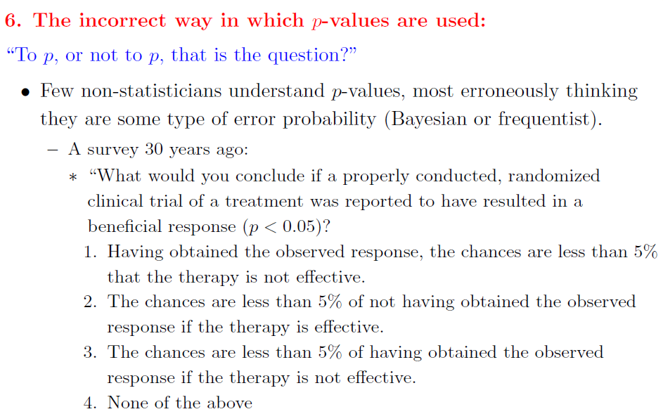
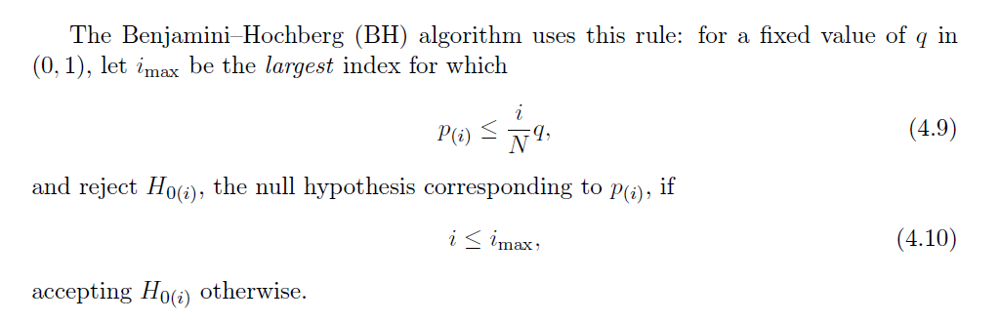

```{r setup, include=FALSE}
options(width = 80)
library(knitr)
knitr::opts_chunk$set(echo = TRUE, warning = FALSE, message = FALSE, cache = TRUE,
                      fig.align = "center", fig.width = 7, fig.height = 4,
                      dpi = 150, comment = " ")
knit_hooks$set(no.main = function(before, options, envir) {
    if (before) par(mar = c(4.1, 4.1, 1.1, 1.1))  # smaller margin on top
})
```

## Acknowledgement

- I have used a few slides from Prof. Jim Berger's talk at Purdue Symposium in 2012 and Prof. Chris Genovese's talk on multiple testing.

- Most of the other examples and texts are following Prof. Brad Efron's 'Large Scale Inference' book and website.

- The intuitive explanation of the Benjamini--Hochberg method follows a presentation by Tan Siew Li, Linda (Department of Statistics and Applied Probability, National University of Singapore).

---
class: center, middle, inverse

# 1. The problem

---
## Example

- Gene expression levels for $6033$ genes from $n_1 = 50$ normal controls and $n_2 = 52$ cancer patients.
- Goal: Identify `differentially expressed' genes.
- Test statistic for testing gene $i$: $z_i = \Phi^{-1}(F_{100}(t_i))$
  where $t_i = \frac{\bar{x_i}(2) - \bar{x_i}(1)}{s_i}$ is $t$-statistic for testing gene $i$.
- $H_{0i}: z_i \sim N(0,1)$.
- In reality, the dependence of the $Z$-values should impact the inference

```{r, echo = FALSE, out.width = "40%"}

```

- `The shape of the histogram suggests the presence of certain interesting genes.' (Efron, 2008).

---
## In R

```{r qq}
load("prostz.Rda")
teststat = prostz
# cat(length(teststat),"\n") # correct data should have 6,033 entries
qqnorm(teststat)
qqline(teststat)
```

---
## In R

```{R hist}
hist(teststat, breaks = 40, freq = F, col = "green")
curve(dnorm(x), col = 2, lty = 2, lwd = 2, add = TRUE)
```

---
## Large Scale Testing

- Suppose for the $i^{th}$ variable $x_{i}$ the two group means are $\theta_{i,1}$ and $\theta_{i,2}$.

$$
H_{0i}: \theta_{i,1} = \theta_{i,2} \text{ vs. } H_{1i}: \theta_{i,1} \neq \theta_{i,2}
$$

- If $H_{0i}$ is true, the group means $\bar{x}_{i,1}$ and  $\bar{x}_{i,1}$ should be close.
- We can do an independent samples test for each of the $p$ variables.

- Note that, it is not necessary to compare the means via a **t-test** always. We can compare medians using **nonparametric tests** e.g. Mann-Whitney / variations using a Siegel-Tukey or an omnibus test using two-sample Kolmogorov-Smirnon test.

---
## Multiple Testing Issues

- We have a large number of tests: 6,033. If we use standard hypothesis testing at a 5% significance level, 5% of all tests will be falsely rejected (type 1 error) just by pure chance.

- We need some kind of multiplicity control.

- We will learn these, but first let's see the issue of multiplicity a little more closely.

---
## Multiple testing

-  Last time, we talked a little bit about multiple testing issues: and showed why the probability of a false rejection would grow as we test more and more hypotheses simultaneously.

- Today, we will learn about methods to control these errors.

- But first one quick reminder about P-values.

---
## Jim Berger's talk at Purdue Symposium (JBPS'12)

```{r, echo = FALSE, out.width = "80%"}

```

-  *What do you think?*

---
## From the talk (JBPS'12)


- Actual correct answer: The chances are less than 5% of having obtained the observed response or any more extreme response if the therapy is not effective.

---
## From the talk

```{r, echo = FALSE, out.width = "85%"}

```

---
class: center, middle, inverse

# 2. Why is multiplicity correction important?

---
## Example with Simulated Data

- 200 observations from a standard normal distribution.
- I want to test $H_0: \theta_i = 0$ for each $i = 1, \ldots, 200$.

```{r, fig.asp = 0.5, echo = T}
set.seed(123)
z = rnorm(200, 0, 1);
hist(z, freq = F, ylim = c(0,0.7)); curve(dnorm, add = T)
```

---
## Testing

-  Applying simple $Z$-test for each coordinate to test $H_0: \theta_i = 0$ vs. $H_1: \theta_i \ne 0$.

```{r, echo = T}
rawp = 2*(1 - pnorm(abs(z)))
reject.indices <- (rawp < 0.05)
sum(reject.indices)
```

- We are falsely rejecting `r sum(reject.indices)` of them! Why? (note: 5% of 200 = 10)

---
## False rejection

- Naively comparing all $n$ P-values to the significance level $\alpha$ would mean that by purely random chance, $n \times \alpha$ of them will be falsely rejected.

- Why?

---
## False Discoveries

- Under the $H_0$, p-values are (1-CDF)'s, i.e. each $p_i \sim U(0,1)$, as long as the test statistics have continuous distribution.

- For example, for $Z$-test, $\text{P-value} = P_{Z \sim N(0,1)}(Z > z) = 1 - \Phi(z)$.

-  This ensures that $P(p_i \le \alpha) = \alpha$, $i = 1, \ldots, m (\text{number of tests})$.

- Probability of error = $\alpha$, Probability of not making an error = $1-\alpha$.

- Assuming independence, probability of not making an error in $m$ tests: $(1-\alpha)^m$.

- P(Making at least 1 error in $m$ tests) = $1-(1-\alpha)^m$.

- Now, if $\alpha \in (0,1)$, the sequence $1-(1-\alpha)^m \to 1$ as $m \to \infty$, in English, the probability of at least one false discovery goes to 1.

---
## How does this grow?

```{r, echo = T}
m = (0:100)
alpha = 0.05
FWEP = 1 - (1-alpha)^m
plot(m,FWEP,type = "l", ylab = "P(at least 1 false positive)")
```

---
class: center, middle, inverse

# 3. Formal definitions etc.

---
## Multiple testing

- Let $M_0$ be the number of null hypotheses that are true, $M_0 = M - M_1$.

|           | $H_0$ acc |	$H_0$ rej  | Total |
|-----------|-----------|------------|-------|
| $H_0$ true|	U         | V          | $M_0$ |
| $H_1$ true|	T         | S          | $M_1$ |
|Total      |	M-R       | R          | $M$   |

- All quantities except $M$ and $R$ are unobserved.

- The problem is to choose a testing procedure that will balance between *false positives* and *false negatives*

- We can use subscript $i$ for the $i^{th}$ test, i.e. $R_i$ be the number of rejections by the $i^{th}$ test and $\sum R_i = R$.

---
## How to choose a threshold?

1. *Uncorrected testing*:
   - Also called 'control per-comparison type I error' (PCER)
   - Gives $P(V_i>0) \le \alpha$ for each test $i = 1, \ldots, M$.

2. *Control Familywise Type I Error (FWER)*
  -  e.g.: Bonferroni: use per-comparison significance level $\alpha/m$
  -  Guarantees $P(V> 0) \le \alpha$.

3. *Control False Discovery Rate (FDR)*
   - first defined by Benjamini and Hochberg (BH, 1995, 2000)
  -  Guarantees $FDR \equiv E(V/R) \le \alpha$.

4.  Many developments since until now ...

---
## FWER and FDR: what is actually different?

Both are statements about the **same table**, but about different quantities.

| | Controls | In words |
|:---|:---|:---|
| **FWER** | $P(V \ge 1) \le \alpha$ | the chance of making *even one* false discovery |
| **FDR** | $E(V/R) \le \alpha$ | the *average proportion* of your discoveries that are false |

--

- FWER treats one false positive among 10 rejections exactly as badly as one among 10,000. FDR does not.

--

- A useful special case: if **every** null is true ( $M_0 = M$ ), then every rejection is false, so $V = R$ and $V/R = 1$ whenever $R>0$. Then

$$\text{FDR} = E(V/R) = P(R > 0) = \text{FWER}.$$

So under the global null the two coincide. FDR control is never *weaker* than FWER control when there is nothing to find.

--

- Rule of thumb: FWER when a single false positive is expensive (confirmatory trials); FDR when the output is a **screening list** that will be followed up anyway.

---
class: center, middle, inverse

# 4. Bonferroni correction

---
## Bonferroni 

```{r, echo = FALSE, out.width = "25%"}

```
-  Carlo Emilio Bonferroni (28 Jan 1982 - 18 August 1960).
-  Bonferroni adjustment for familywise error rate bears his name but it was developed by Olive Dunn. 
-  Bonferroni's inequality provides upper and lower bounds for probabilities of finite unions of events. 
-  Sadly, "much of his work is not well known b/c his books were never typeset. He thought books too expensive for students so he had his books printed from his handwritten teaching materials". 

---
## Bonferroni Procedure

- $M$ hypothesis tests: $H_{0i}$ vs. $H_{1i}$ for $i = 1, \ldots, M$.
- Let $p_1, \ldots, p_M$ be the p-values for these $M$ tests.
- In our case $M = p$ (no. of genes)
- Bonferroni method:

$$
\text{Reject null hypothesis } H_{0i} \text{ if } p_i \le \frac{\alpha}{M}
$$

- Outcome: The probability of falsely rejecting any null hypothesis is less than or equal to $\alpha$.

---
## Bonferroni

- Bonferroni's correction controls for the familywise error rate (FWER) instead of each $\alpha$.

$$
FWER = P(\text{at least one false rejection}) \le \alpha
$$

- Bonferroni leads to a stringent test, since $\alpha/M$ could be very small if we are carrying out a large number of $M$ tests simultaneously.
- Let us look at the proof of Bonferroni procedure.

---
## Proof 

- Boole's inequality: $P\{ \cup A_i \} \le \sum P\{ A_i \}$
- Now, let $I_0$ denote the indices of the true null hypotheses (for which $\theta_i$ is actually zero,) and there are $M_0$ of them.
- Then, for Bonferroni


$$FWER = P\left\{\cup_{I_0} \left( p_i \le \frac{\alpha}{M} \right) \right\} \le \sum_{I_0} P(p_i \le \frac{\alpha}{M}) = M_0 \frac{\alpha}{M} \le \alpha$$

- Notice this never used independence. 

- Boole's inequality holds for *any* dependence. That robustness is exactly why Bonferroni is so conservative.

---
## Bonferroni in R

- In R, we can apply the `p.adjust` function for this task.

- `p.adjust` also has other useful methods such as "Benjamini-Hochberg False Discovery Rate control procedure".

```{r, echo = T}
rawp = 2 * (1 - pnorm(abs(teststat)))
selected  <- p.adjust(rawp, method = "bonferroni") < 0.05
sum(selected)
```

- Bonferroni's correction leads to rejection of `r sum(selected)` tests - these genes significantly differ between two groups.

- **Does it seem too small?**


---
class: center, middle, inverse

# 6. Benjamini--Hochberg, formally

---
## Benjamini-Hochberg

- The Benjamini and Hochberg procedure for multiple testing offers an alternative to the Bonferroni's FWER control procedure, that offers a less stringent testing mechanism for high-dimensional data.

-  The main idea is that instead of controlling the familywise error rate, i.e. the probability of at least one false rejection, we control the average proportion of false discoveries, also called false discovery rate or FDR.

-  It turns out that the Benjamini-Hochberg method is less stringent and has many attractive properties for high-dimensional data and often recognized as a state-of-the-art procedure for multiple testing. We describe the testing procedure below.

---
## Benjamini-Hochberg

- Let $M_0$ be the number of null hypotheses that are true, $M_0 = M - M_1$.

|           | $H_0$ acc |	$H_0$ rej  | Total |
|-----------|-----------|------------|-------|
| $H_0$ true|	U         | V          | $M_0$ |
| $H_1$ true|	T         | S          | $M_1$ |
|Total      |	M-R       | R          | $M$   |

- Define the false discovery proportion (FDP):

$$FDP = \begin{cases}
V/R \text{ if } R > 0 \\
0 \text { otherwise}
\end{cases}$$

-  The false discovery rate is the expected value or average of false discovery proportions. This is what the BH procedure controls. 

---
## Benjamini-Hochberg procedure

- $M$ hypothesis tests We order the p-values in increasing order.
$p_{(1)} \le \ldots \le p_{(M)}$.

- *Benjamini-Hochberg Method*

**Step 1.** For a given $\alpha$ find the largest $k$ such that

$$
p_{(k)} \le k \frac{\alpha}{M}
$$

**Step 2.** Then reject all $H_{0m}$ for $m = 1, \ldots, k$.
-  *Theorem* :

$$
FDR = E(FDP) \le \frac{M_0}{M}\alpha \le \alpha
$$

-  *Outcome*: For a given significance level $\alpha$, the Benjamini Hochberg method bounds the false discovery rate.

---
## A subtlety: BH is a *step-up* procedure

The set $\{\, j : p_{(j)} \le j\alpha/M \,\}$ **need not be contiguous.** You
take the *largest* such $j$, then reject everything up to it, including
$p$-values that fail their own inequality.

```{r stepup, echo = TRUE}
p.toy <- c(0.001, 0.012, 0.014, 0.019, 0.022, 0.029, 0.30, 0.45, 0.70, 0.85)
Mt <- length(p.toy); at <- 0.05
data.frame(j        = 1:Mt,
           p        = p.toy,
           threshold = (1:Mt) * at / Mt,
           passes    = p.toy <= (1:Mt) * at / Mt)
```

---
## A subtlety: BH is a *step-up* procedure

```{r stepup2, echo = TRUE}
max(which(p.toy <= (1:Mt) * at / Mt))        # L
sum(p.adjust(p.toy, method = "BH") <= at)    # what R rejects
sum(p.toy <= at / Mt)                        # what Bonferroni rejects
```

- $j = 2$ **fails**, yet $p_{(2)}$ is rejected, because $j = 6$ passes and BH rejects everything up to $L = 6$.
- Bonferroni here rejects 1 of 10; BH rejects 6.
- A "step-down" process would have stopped at the first failure. That is it would reject only 1 and would not control FDR at the stated level.

---
## Benjamini--Hochberg in R

- Recall the prostate cancer dataset. 

```{r bhinr}
load("prostz.Rda")
teststat = prostz
hist(teststat, breaks = 40, freq = F, col = "green")
curve(dnorm(x), col = 2, lty = 2, lwd = 2, add = TRUE)
```

---
## Benjamini-Hochberg in R

```{r, echo = T}
rawp = 2 * (1 - pnorm(abs(teststat)))
selected  <- p.adjust(rawp, method = "BH") < 0.05
sum(selected)
```

- Benjamini-Hochberg method leads to rejection of `r sum(selected)` tests. 

```{r}
selected.bon  <- p.adjust(rawp, method = "bonferroni") < 0.05
sum(selected.bon)
```

- Bonferroni rejects `r sum(selected.bon)` tests: Benjamini-Hochberg is less stringent than Bonferroni.

---
## Benjamini--Hochberg algorithm

- The best thing about this algorithm is that it is easy enough to code up, so that you don't have to depend on packages.

- Let us look at the algorithm again !

```{r, echo = FALSE, out.width = "100%"}

```

---
## Benjamini--Hochberg algorithm

```{R manual}
eval.bh <- function(y,q = 0.05)
{
  n <- length(y)
  pval <- 2*(1-pnorm(abs(y)))
  upper.bound <- (1:n)*q/n
  sorted.pval <- sort(pval, decreasing = FALSE)
  ind <- which(sorted.pval <= upper.bound)
  if(any(ind))
  {
    bh.thres <- sorted.pval[max(ind)]
  }else{
    bh.thres <- 0
  }
  bh.index <-(pval<=bh.thres)
  return(list(reject.indices = bh.index, sorted.p = sorted.pval, upper.bound = upper.bound))
}
```

---
## Try it

```{r}
fit <- eval.bh(teststat, 0.05)
sum(fit$reject.indices)
```

```{r}
sum(p.adjust(2*(1-pnorm(abs(teststat))), method = "BH") <= 0.05)
```

- The hand-written version and `p.adjust` agree, which is the check worth doing whenever you roll your own.

---
## Proof

-  The original proof that BH algorithm controls the false discovery rate at $\alpha$ was a long argument (See [Benjamini & Hochberg (1995).](http://engr.case.edu/ray_soumya/mlrg/controlling_fdr_benjamini95.pdf)), but Efron uses a Martingale argument that makes it into half a page.

-  Here is another hand-wavy argument.

---
class: center, middle, inverse

# 5. Understanding Benjamini--Hochberg

### Where does the rule $p_{(j)} \le j\alpha/M$ come from?

---
## False discovery rate

- The false discovery rate (FDR) is the **expected proportion** of tests which are incorrectly called significant out of all the tests which are called significant.

- The table below lists all possible outcomes from $M$ hypothesis tests. Thus $\text{FDR} = E(V/R)$.

| | Not called significant | Called significant | Total |
|:---|:---:|:---:|:---:|
| $H_0$ true | $U$ | $V$ | $M_0$ |
| $H_0$ false | $T$ | $S$ | $M_1$ |
| Total | $M - R$ | $R$ | $M$ |

- The Benjamini--Hochberg (BH) method is a procedure which controls the false discovery rate so that $\text{FDR} \le \alpha$.

---
## The Benjamini--Hochberg method

Suppose we have computed the $p$-values for $M$ hypothesis tests,

$$H_{0j} \quad \text{vs} \quad H_{1j}, \qquad j = 1, \ldots, M.$$

> **Benjamini--Hochberg Method.** To control $\text{FDR} \le \alpha$:
>
> 1. Let $p_{(1)} \le \cdots \le p_{(M)}$ be the **ordered** $p$-values.
> 2. Define $L = \max\{\, j : p_{(j)} < \alpha j / M \,\}$.
> 3. Reject all hypotheses $H_{0j}$ for which $p_j \le p_{(L)}$.

--

**Why does the Benjamini--Hochberg method work?**

The rest of this section builds the answer from a simulation, so that the
rule stops looking arbitrary.

---
## The set-up we will simulate

Suppose we wish to perform $M$ hypothesis tests of the form

$$H_{0j} : \mu_{1j} = \mu_{2j} \quad \text{vs} \quad H_{1j} : \mu_{1j} \ne \mu_{2j}, \qquad j = 1,\ldots,M,$$

where $\mu_{1j}$ and $\mu_{2j}$ are the population means of the two groups in the $j$th test.

- For example, we may have gene expression measurements for two groups of patients for $M$ genes, and we want to identify the genes for which the two groups differ.

- Let $M = 10{,}000$.

- Suppose out of these $M$ tests there are **actually** $M_0 = 9000$ tests for which $H_0$ is true and $M_1 = 1000$ tests for which $H_0$ is false.

- The whole point of the simulation is that *we know the answer*, so we can check what any procedure actually delivers.

---
## Data simulation

- Two groups, each of size 25.

- For $j = 1,\ldots,10000$, generate $\mu_{1j}$ from $N(0,1)$.
  - For $j \le 9000$ set $\mu_{2j} = \mu_{1j}$ (true null)
  - For $j > 9000$ set $\mu_{2j} = \mu_{1j} + 1$ (a real effect)
  
- So, we have a 1000 signals and 9000 null hypothesis. 

- Then generate the observations

$$x_{ij} \sim \begin{cases} N(\mu_{1j}, 1) & \text{if observation } i \text{ is in group 1,}\\ N(\mu_{2j}, 1) & \text{if observation } i \text{ is in group 2,}\end{cases}$$

for $j = 1,\ldots,M$ and $i = 1,\ldots,50$.

---
## Data simulation in R

```{r sim-data, echo = TRUE}
set.seed(2024)
Msim  <- 10000      # number of tests
M0sim <-  9000      # number of them for which H0 is TRUE
ngrp  <-    25      # observations per group

mu1 <- rnorm(Msim, 0, 1)
mu2 <- mu1
mu2[(M0sim + 1):Msim] <- mu1[(M0sim + 1):Msim] + 1   # the 1000 real effects

# each row is one test: 25 observations per group
g1 <- matrix(rnorm(Msim * ngrp), Msim, ngrp) + mu1
g2 <- matrix(rnorm(Msim * ngrp), Msim, ngrp) + mu2

isnull <- rep(c(TRUE, FALSE), c(M0sim, Msim - M0sim))
```

---
## The $p$-values

A vectorised two-sample $t$-test, one per row:

```{r sim-pvals, echo = TRUE}
m1 <- rowMeans(g1);  m2 <- rowMeans(g2)
v1 <- rowSums((g1 - m1)^2) / (ngrp - 1)
v2 <- rowSums((g2 - m2)^2) / (ngrp - 1)
sp2 <- ((ngrp - 1) * v1 + (ngrp - 1) * v2) / (2 * ngrp - 2)   # pooled variance
tstat <- (m1 - m2) / sqrt(sp2 * (2 / ngrp))
psim  <- 2 * pt(-abs(tstat), df = 2 * ngrp - 2)
round(head(psim), 4)
```

---
## Distribution of $p$-values

```{r sim-hist-split, echo = TRUE, fig.width = 9, fig.height = 3.6}
par(mfrow = c(1, 2))
hist(psim[isnull],  breaks = 20, col = "grey85",
     main = expression(H[0] ~ "is true"),  xlab = "p-value")
hist(psim[!isnull], breaks = 20, col = "grey85",
     main = expression(H[0] ~ "is false"), xlab = "p-value")
```

- Left: the $p$-values for which $H_0$ is true are **uniform on $(0,1)$**.
- Right: the $p$-values for which $H_0$ is false pile up near zero.

---
## What happens if we combine all the $p$-values?

```{r sim-hist-all, echo = TRUE, fig.width = 6.5, fig.height = 3.6}
h <- hist(psim, breaks = 20, col = "grey85",
          main = "All p-values", xlab = "p-value")
flat <- mean(h$counts[-1])          # average height of blocks 2..20
abline(h = flat, col = "red", lwd = 2)
```

- Most $p$-values are uniform between 0 and 1, but there is a **spike** close to zero. That spike is the $p$-values for which $H_0$ is false.

---
## Reading the histogram

The flat part is made of nulls. Anything above it, in the first block, is signal.

```{r sim-estimate, echo = TRUE}
c(first.block   = h$counts[1],
  flat.level    = round(flat, 1),
  excess        = round(h$counts[1] - flat),
  true.M1       = Msim - M0sim)
```

- Height of the first block is `r h$counts[1]`; the average height of the 2nd to 20th block is `r round(flat,1)`.
- So an estimate of the number of hypotheses which are false, and should be rejected, is `r round(h$counts[1] - flat)`.
- The true value is `r Msim - M0sim`. **Not bad for a histogram.**

---
## But *which* ones do we reject?

The first block contains `r h$counts[1]` $p$-values, and only about
`r round(h$counts[1] - flat)` of them are real. A good rule of thumb is to
reject the **smallest** `r round(h$counts[1] - flat)` of them.

```{r sim-naive, echo = TRUE}
k    <- round(h$counts[1] - flat)
ord  <- order(psim)
Vk   <- sum(isnull[ord[1:k]])          # how many of those are actually null?
c(rejected = k, false.discoveries = Vk, FDP = round(Vk / k, 3))
```

--

- The false discovery proportion is about `r round(Vk/k, 3)` : **above** 0.10.
- So this rule of thumb overshoots. We need a principled way to decide how far down the sorted list to go. That is exactly what BH does.

---
## Applying the Benjamini--Hochberg method

Sort the $p$-values, draw a line through the origin with gradient $\alpha/M$,
and find the **last** point that falls below it.

```{r sim-bh, echo = TRUE}
alpha <- 0.10
psort <- sort(psim)
j     <- 1:Msim
below <- which(psort <= j * alpha / Msim)
L     <- max(below)
VL    <- sum(isnull[ord[1:L]])
c(L = L, false.discoveries = VL, FDP = round(VL / L, 4), alpha = alpha)
```

- Here $L =$ `r L`, and the realised false discovery proportion is below $\alpha = 0.10$.

---
## The picture, full scale

```{r sim-bh-plot, echo = FALSE, fig.width = 6.5, fig.height = 4}
plot(j, psort, type = "n", xlab = "j (rank of the p-value)", ylab = "p-value")
points(j[j >  L], psort[j >  L], pch = 20, col = "seagreen")
points(j[j <= L], psort[j <= L], pch = 20, col = "navy")
abline(0, alpha / Msim, col = "red", lwd = 2)
legend("topleft", bty = "n",
       legend = c("rejected", "not rejected", expression(p == alpha*j/M)),
       col = c("navy", "seagreen", "red"), pch = c(20, 20, NA), lty = c(NA, NA, 1))
```

---
## The picture, zoomed in

```{r sim-bh-zoom, echo = FALSE, fig.width = 6.5, fig.height = 4}
zm <- 1:1300
plot(zm, psort[zm], type = "n", xlab = "j", ylab = "p-value")
points(zm[zm >  L], psort[zm[zm >  L]], pch = 20, col = "seagreen")
points(zm[zm <= L], psort[zm[zm <= L]], pch = 20, col = "navy")
abline(0, alpha / Msim, col = "red", lwd = 2)
abline(v = L, lty = 3)
```

The crossing point is $L$. Everything to its left is rejected.

---
## Why does it work? The geometry

Recall there are $M_0$ $p$-values for which $H_0$ is true, and they are
**uniformly distributed** on $(0,1)$. So the expected number of null
$p$-values lying in any interval $[0,h]$ is $M_0 h$.

```{r why-schematic, echo = FALSE, fig.width = 6, fig.height = 3.3}
par(mar = c(2, 2, 1, 1))
plot(NA, xlim = c(-0.12, 1.15), ylim = c(-0.12, 1.2), axes = FALSE, xlab = "", ylab = "")
arrows(0, 0, 1.12, 0, length = 0.08); arrows(0, 0, 0, 1.12, length = 0.08)
segments(0, 0, 1, 1, col = "red", lwd = 2)
Lx <- 0.62
segments(Lx, 0, Lx, Lx, lty = 3); segments(0, Lx, Lx, Lx, lty = 3)
segments(1, 0, 1, 1, lty = 3);    segments(0, 1, 1, 1, lty = 3)
text(Lx, -0.07, "L"); text(1, -0.07, "M")
text(-0.06, Lx, "h"); text(-0.06, 1, expression(alpha))
text(0.30, 1.05, expression(frac(h, L) == frac(alpha, M)), cex = 1.1)
text(0.72, 0.72, expression(~~ h == frac(alpha * L, M)), cex = 1.1)
```

---
## Why does it work? The algebra

- Consider the red line with gradient $\alpha/M$. Let $L$ be the rank of the largest $p$-value that falls below this line, so we reject the smallest $L$ $p$-values.

- From the similar triangles, the cutoff height is $h = \alpha L / M$.

- The expected number of $p$-values among these for which $H_0$ is true (i.e., the false discoveries) is at most

$$M_0 h = M_0 \frac{\alpha L}{M}.$$

- Therefore

$$\text{FDR} \;\le\; \frac{M_0 \frac{\alpha L}{M}}{L} \;=\; \alpha \frac{M_0}{M} \;\le\; \alpha. \qquad \blacksquare$$

--

- Notice what the bound gives you for free: the procedure is conservative by exactly the factor $M_0/M$. If only half your hypotheses are null, BH is really controlling FDR at $\alpha/2$. 

---
## The same rule, read a different way

The BH inequality can be rearranged:

$$p_{(j)} \le \frac{j\alpha}{M} \qquad \Longleftrightarrow \qquad \frac{M\, p_{(j)}}{j} \le \alpha.$$

--

- If you cut at $p_{(j)}$, the expected number of **nulls** below the cut is $M_0 p_{(j)} \le M p_{(j)}$.
- You made $j$ rejections.
- So $M p_{(j)} / j$ is a (conservative) estimate of the **false discovery proportion** at that cutoff.

--

> **BH in one sentence:** walk down the sorted $p$-values and go as far as you can while the estimated FDP stays below $\alpha$.

That is why the threshold *moves with the data*: Bonferroni uses the fixed cutoff $\alpha/M$ (the $j = 1$ case), while BH is allowed to relax it to $\alpha j /M$ precisely because it has already made $j$ rejections to dilute the false ones.

---
## Control is "on average", not per dataset

$\text{FDR} = E(V/R)$ is an **expectation**. Any single dataset can come out above $\alpha$.

```{r fdr-replicates, echo = TRUE, cache = TRUE, fig.width = 6.5, fig.height = 3.2}
one.fdp <- function(alpha = 0.10) {
  mu1 <- rnorm(Msim, 0, 1); mu2 <- mu1
  mu2[(M0sim + 1):Msim] <- mu1[(M0sim + 1):Msim] + 1
  a <- matrix(rnorm(Msim * ngrp), Msim, ngrp) + mu1
  b <- matrix(rnorm(Msim * ngrp), Msim, ngrp) + mu2
  ma <- rowMeans(a); mb <- rowMeans(b)
  s2 <- (rowSums((a - ma)^2) + rowSums((b - mb)^2)) / (2 * ngrp - 2)
  p  <- 2 * pt(-abs((ma - mb) / sqrt(s2 * (2 / ngrp))), df = 2 * ngrp - 2)
  o  <- order(p); ps <- p[o]
  bl <- which(ps <= (1:Msim) * alpha / Msim)
  if (!length(bl)) return(0)
  LL <- max(bl); sum(isnull[o[1:LL]]) / LL
}
set.seed(11)
fdps <- replicate(40, one.fdp())
```

---

```{r fdr-replicates-plot, echo = FALSE, fig.height = 3.4}
hist(fdps, breaks = 12, col = "grey85", xlab = "realised FDP",
     main = "40 repetitions of the whole experiment")
abline(v = 0.10, col = "red", lwd = 2)
abline(v = mean(fdps), col = "navy", lwd = 2, lty = 2)
legend("topright", c("alpha = 0.10", "mean FDP"), col = c("red","navy"),
       lty = c(1,2), lwd = 2, bty = "n")
```

```{r, echo = TRUE}
c(mean.FDP = round(mean(fdps), 4), bound.alpha.M0.over.M = 0.10 * M0sim / Msim,
  prop.above.alpha = mean(fdps > 0.10))
```

- The mean is very close to the theoretical bound $\alpha M_0/M$, but a few individual runs still exceed $\alpha$. **That is not a failure of the method.**

---
## Bonferroni vs BH on the very same data

```{r bonf-vs-bh, echo = TRUE}
bonf.rej <- psim <= 0.05 / Msim
bh.rej   <- p.adjust(psim, method = "BH") <= 0.10
rbind(
  Bonferroni = c(rejections = sum(bonf.rej),
                 false      = sum(isnull & bonf.rej),
                 found      = sum(!isnull & bonf.rej)),
  BH         = c(rejections = sum(bh.rej),
                 false      = sum(isnull & bh.rej),
                 found      = sum(!isnull & bh.rej))
)
```

- There are **1000** real effects in this data set.
- Bonferroni makes no false discoveries but it also misses most of the signal.
- BH accepts a handful of false positives and recovers the great majority of it.

--

Neither is "right". They answer different questions.

---
class: center, middle, inverse

# 7. Making BH less conservative

---
## The $M_0/M$ slack

We proved $\text{FDR} \le \alpha \dfrac{M_0}{M}$. If you knew $M_0$ you could
run the procedure at level $\alpha M / M_0$ and still be valid.

In other words, you get more power, for free.

--

- Write $\pi_0 = M_0/M$, the proportion of true nulls.
- We **already estimated it**, back on the histogram slide: the flat level is
  made of nulls, so

$$\hat\pi_0 \approx \frac{\text{flat level} \times \text{number of blocks}}{M}.$$

```{r pi0, echo = TRUE}
pi0.hat <- flat * length(h$counts) / Msim
c(pi0.hat = round(pi0.hat, 3), truth = M0sim / Msim)
```

- That is the idea behind **Storey's** $q$-value and the *adaptive* BH procedures.

---
## Which is what `multtest` is offering you

When we call `mt.rawp2adjp(rawp, c(..., "ABH", "TSBH"))` later, those two are:

| Label | Name | Idea |
|:---|:---|:---|
| `BH` | Benjamini--Hochberg | threshold $j\alpha/M$ |
| `ABH` | **Adaptive** BH | estimate $M_0$, use $j\alpha/\hat M_0$ |
| `TSBH` | **Two-stage** BH | run BH once to estimate $M_0$, then re-run |
| `BY` | Benjamini--Yekutieli | divide by $\sum_{j=1}^{M} 1/j$ for dependence |

--

- Adaptive methods buy power when $\pi_0$ is well below 1 (lots of real signal).
- When almost everything is null, $\hat\pi_0 \approx 1$ and they reduce to ordinary BH, so you lose nothing.
- The catch: $\hat\pi_0$ is itself estimated, so the FDR guarantee becomes approximate.

---
class: center, middle, inverse

# 8. A second example

---
## Example from T-cell lymphoma

```{r,echo=TRUE, message=FALSE, warning=FALSE, cache=T}
## required for gene expression data classification example
require(ALL)
data(ALL)
dim(ALL)
```

---
## Simplifying features

We are going to use the first three features.

```{r, echo=TRUE}
resp <- gsub("B[0-9]", "B", ALL$BT)
## B-cell tumors of type B, B1,B2, T, T1, T2
resp <- factor(gsub("T[0-9]", "T", resp))
xmat <- t(exprs(ALL))
mydata <- data.frame(y = resp,x1 = xmat[,1],x2=xmat[,2],x3=xmat[,3])
head(mydata,n=3)
```

---
## Further Analysis

-  Let's look at the results of molecular biology testing for the 128 samples:

```{r, echo = T}
table(ALL$mol.biol)
```

- Not all levels are frequent !

---
## Filter

Ignoring the samples which came back negative on this test (NEG), most have been classified as (BCR/ABL) or (ALL1/AF4).

For the purposes of this example, we are only interested in these two subgroups, so we will create a filtered version of the dataset using this as a selection criteria:

```{r, echo = T}
eset <- ALL[, ALL$mol.biol %in% c("BCR/ABL", "ALL1/AF4")]
dim(eset)
```

---
## How do we analyze this data?

- We have the expression levels 12,625 genes for 47 samples.
- We also have a factor `ALL$mol.biol` that has two levels: BCR/ABL and ALL1/AF4.
- We can ask for which genes, the gene expression values differ between these two subgroups?
- Two sample tests !

---
## Simple test

- One idea would be use a two sample t-test for equality of group mean for each of the 12,625 genes.
- The `mt.teststat` function from the `multtest` library does this for you.

```{r, echo = T, cache=T}
require(multtest)
all.mat = exprs(eset)
all.cl <- factor(as.character(eset$mol.biol))
teststat = mt.teststat(all.mat,all.cl,test="t")
```

- The two datasets `all.mat` and `all.cl` are all you need.
- `all.mat` has the gene expression values and `all.cl` gives the class labbels.
- mt.teststat {multtest}: **Package for computing test statistics for each row of a data frame**.

---
## Why t-test?

- These functions provide a convenient way to compute test statistics, e.g., two-sample Welch t-statistics, **Wilcoxon statistics**, F-statistics, paired t-statistics, block F-statistics, for each row of a data frame.
- Should we use a t-test or a different test?
- Depends on whether you believe in normality assumption for each test or have sufficient data for CLT to kick in.

---
## Visualize data

- QQplot/overlaid histogram: visual inspection of normality. Departure from diagonal (QQ) or bell-shape suggests presence of signals.

```{r, echo = F, fig.width = 9, fig.height = 3.6}
par(mfrow=c(1,2))
qqnorm(teststat, ylim = c(-5,5))
qqline(teststat)
hist(teststat, breaks = 30, col = "red", freq = F, xlim = c(-5,5), ylim = c(0,0.5))
curve(dnorm(x), lty = 2, lwd = 2, add=TRUE)
curve(dnorm(x, mean = mean(teststat), sd = sd(teststat)), lty = 3, lwd = 2, add=TRUE)
```

- Histogram and N(0,1) density different on the tails - a few interesting genes?

---
## Multiple Testing

-  You need to test for significance all the 12,625 rows/genes, get P-values for each of them and then apply multiple testing correction as shown above.
-  Perform at least two different tests and two different multiplicity corrections, e.g. Bonferroni and Benjamini-Hochberg corrections.

---
## Bonferroni

- Recall: Bonferroni's correction controls for the familywise error rate (FWER) instead of each $\alpha$.

$$
FWER = P(\text{at least one false rejection}) \le \alpha
$$

```{r, echo = T}
rawp = 2 * (1 - pnorm(abs(teststat)))
selected  <- p.adjust(rawp, method = "bonferroni") < 0.05
sum(selected)
```

- Bonferroni's correction leads to rejection of `r sum(selected)` tests - these genes significantly differ between two groups

---
## Benjamini-Hochberg in R

```{r, echo = T}
rawp = 2 * (1 - pnorm(abs(teststat)))
selected  <- p.adjust(rawp, method = "BH") < 0.05
sum(selected)
```

- Benjamini-Hochberg finds `r sum(selected)` genes here, against the handful Bonferroni allowed.

---
## The same picture, on the real data

```{r all-hist, echo = TRUE, fig.width = 6.5, fig.height = 3.4}
hist(rawp, breaks = 20, col = "grey85", main = "ALL data: all p-values",
     xlab = "p-value")
abline(h = mean(hist(rawp, breaks = 20, plot = FALSE)$counts[-1]),
       col = "red", lwd = 2)
```

- Same shape as the simulation: a flat null carpet with a spike on the left. The spike is what BH is trying to harvest.

---
## Using package

- `multtest` package also has own functions for applying multiple testing correction.

```{r}
## Multiple testing
library(multtest)
rawp = 2 * (1 - pnorm(abs(teststat)))
adjusted = mt.rawp2adjp(rawp, c("Bonferroni", "BH"))
rejected <- mt.reject(adjusted$adj[order(adjusted$index), ], 0.05)
rejected$r
```

---
## Using package

- We can compare a bunch of corrections:

```{r}
adjusted = mt.rawp2adjp(rawp, c("Bonferroni", "BH", "BY", "ABH", "TSBH"))
rejected <- mt.reject(adjusted$adj[order(adjusted$index), ], 0.05)
rejected$r
```

- I'll talk about one more procedure, here abbreviated as "BY"

---
class: center, middle, inverse

# 9. Dependence

---
## Dependence?

-  The Benjamini--Hochberg procedure assumes that the P-values (and the underlying test statistics) are independent of each other.

- This is not always true in real life, and as a result the outcomes of Benjamini-Hochberg often tend to be anti-conservative.

-  Benjamini & Yekutieli (2001) proposed a modification for the BH procedure that takes dependence into account.

-  You can apply their approach by simply changing `method = BH` to `method = BY` in your `p.adjust` function.

- You should investigate whether there is a strong dependence in your data (i.e. dependence between genes), and whether applying BY instead of BH changes your conclusion.

---
## Benjamini-Yekutieli

- BH is a lot more liberal than FWER control.
- This is good for large M; for small M, the story is different, because FWER is actually reasonably workable for small problems.
- BH is nice, elegant and useful, it does have drawbacks:
- One is the independence assumption. You can drop independence if you use:

$$
p(i) \le \frac{iq}{M}\frac{1}{\sum_{j=1}^{i} \frac{1}{j}}
$$

- $M$ is the total number of tests, $q$ is desired control. The correction factor can be large, i.e. the test could be conservative.

---
## How big is that correction?

$\sum_{j=1}^{M} 1/j \approx \log M + 0.577$, so the penalty grows only
logarithmically — but it is not small at genomic scale:

```{r by-penalty, echo = TRUE}
Ms <- c(10, 100, 1000, 6033, 12625)
data.frame(M = Ms, harmonic.sum = round(sapply(Ms, function(m) sum(1/(1:m))), 2))
```

- At $M = 12{,}625$ you are dividing the threshold by about 10. That is still far gentler than Bonferroni, which divides by $M$ itself.
- BY is valid under *arbitrary* dependence; BH is valid under independence and under positive regression dependence (PRDS), which covers many realistic cases.

---
## Benjamini-Yekutieli

```{r, echo = T}
rawp = 2 * (1 - pnorm(abs(teststat)))
selected  <- p.adjust(rawp, method = "BY") < 0.05
sum(selected)
```

---
## Putting the three side by side

```{r three-way, echo = TRUE}
sapply(c("bonferroni", "BH", "BY"),
       function(m) sum(p.adjust(rawp, method = m) < 0.05))
```

- Bonferroni $\le$ BY $\le$ BH, always — each is a strictly weaker correction than the one before.
- The gap between BY and BH is the price of not being willing to assume independence.

---
class: center, middle, inverse

# 10. Summary and references

---
## Summary

| Procedure | Controls | Threshold on $p_{(j)}$ | When |
|:---|:---|:---|:---|
| Uncorrected | PCER | $\alpha$ | never, at scale |
| Bonferroni | FWER | $\alpha/M$ | few tests, any dependence |
| Holm | FWER | step-down, uniformly beats Bonferroni | few tests |
| **BH** | **FDR** | $j\alpha/M$ | screening, independence/PRDS |
| BY | FDR | $j\alpha/(M \sum_{i \le j} 1/i)$ | arbitrary dependence |
| ABH / TSBH | FDR | $j\alpha/\hat{M_0}$ | lots of signal |

--

Three things to carry away:

1. $p$-values are uniform under the null — everything above is built on that one fact.
2. BH walks down the sorted list while the **estimated FDP** stays under $\alpha$.
3. FDR is controlled **in expectation**. Your particular dataset may exceed it.

---
## Literature for Multiple Testing

-  The original paper by Benjamini & Hochberg is here: [Benjamini & Hochberg (1995).](http://engr.case.edu/ray_soumya/mlrg/controlling_fdr_benjamini95.pdf).

-  Manual for the R package `multtest`: [multtest manual.](https://www.bioconductor.org/packages/release/bioc/manuals/multtest/man/multtest.pdf)

- For more details about large scale inference including multiple testing, an excellent reference is Prof. Bradley Efron's monograph on this subject. You can download the pdf copy of the book from Prof. Efron's webpage here:
[Large Scale Inference - Efron (2010)](https://statweb.stanford.edu/~ckirby/brad/LSI/monograph_CUP.pdf). The first 4 chapters are pertinent for this project and the whole book is a very nice read if you want to learn about large scale inferences.

- Benjamini, Y. and Yekutieli, D. (2001). The control of the false discovery rate in multiple testing under dependency. *Annals of Statistics* **29**, 1165--1188.

- Storey, J. D. (2002). A direct approach to false discovery rates. *JRSS-B* **64**, 479--498 — where the $\hat\pi_0$ idea and $q$-values come from.

<!-- ## Nonparametric test -->

<!-- -  We can use the `mt.teststat` function from the `multtest` package as shown above  but choose a different test other than the Student's `t` test.  -->
<!-- -  Since we know how to do any nonparametric test covered in class for two independent samples, we can use them on each gene and calculate P-values for each gene, using a for loop.  -->

<!-- ```{r, echo = T} -->
<!-- dim(all.mat) -->
<!-- dim(all.cl) -->
<!-- str(all.cl) -->
<!-- ``` -->

<!-- A simple two-sample nonparametric test for the first row, i.e. one single gene is shown below:  -->

<!-- ```{r, echo = T} -->
<!-- all.mat.af4 = all.mat[,all.cl=='ALL1/AF4'] -->
<!-- all.mat.abl = all.mat[,all.cl=='BCR/ABL'] -->

<!-- wilcox.test(all.mat.af4[1,],all.mat.abl[1,]) -->
<!-- ``` -->
