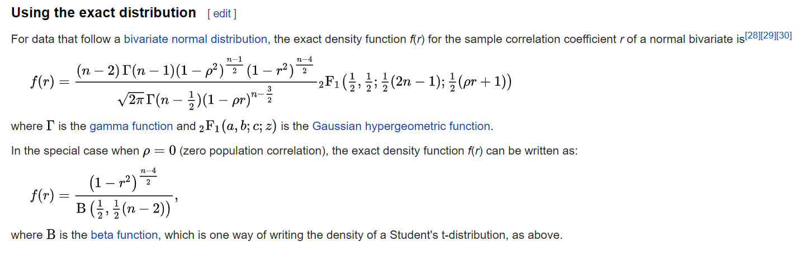

```{r setup, include=FALSE, purl=FALSE}
knitr::opts_chunk$set(echo = TRUE, eval = TRUE, comment= ' ',warning=FALSE, message=FALSE, fig.show='asis',results='markup', fig.width=6.5, fig.height=3.5, fig.align='center',  linewidth=60, tidy=TRUE, tidy.opts=list(width.cutoff=60))


local({r <- getOption("repos"); r["CRAN"] <- "http://R.research.att.com"; options(repos=r)})

setwd("C:/Users/jyotishka/OneDrive/Documents/Course Notes/nonparametric/quarto")
```

---
class: center, middle

# Cross-validation vs. the Bootstrap

Cross-validation: provides <span style="color:#0000FF">estimates</span> of the (test) <span style="color:#FF6921">error</span>

The Bootstrap: provides the (standard) <span style="color:#FF6921">error</span> of <span style="color:#0000FF">estimates</span>

---
## What is Bootstrap?

- Wikipedia: group of metaphors which refer to a self-sustaining process that proceeds without external help.
- In Statistics, Bootstrap is a procedure that helps us get an idea about the distribution of a test statistic by resampling from the sample that produces the statistic.
- Introduced by Brad Efron in 1979 - spread like a bushfire in scientific disciplines within a couple of decades.

```{r, echo = FALSE, out.width = "80%"}
knitr::include_graphics("art/bootstrap_cite.jpg")
```

*One of the most-cited papers*

---
## Introduction & Motivation

- Goal: **Summarize** a sample based study and **generalize** the finding to the parent population, using sample statistics are sample mean, sample median, sample standard deviation etc.

- Sample mean will fluctuate from sample to sample and we would like to know **the magnitude of these fluctuations** around the corresponding population parameter in an overall sense.

- This is then used in assessing the <span style="color:#E60019">Margin of Errors</span>.

- The entire picture of all possible values of a sample statistics presented in the form of a probability distribution is called a **sampling distribution.**

---
## Sampling distribution

- There is a plenty of theoretical knowledge of sampling distributions, which can be found in any text books of mathematical statistics.

| Population | Statistic | Sampling distribution |
|:---|:---|:---|
| Normal: $\mathcal{N}(\mu ,\sigma ^{2})$ | Sample mean $\bar{X}$ from samples of size $n$ | $\bar{X} \sim \mathcal{N}\left(\mu ,\frac{\sigma ^{2}}{n}\right)$ |
| Bernoulli: $\operatorname{Bern}(p)$ | Sample proportion of "successful trials" $\bar{X}$ | $n\bar{X} \sim \operatorname{Bin}(n,p)$ |
| Two independent normal populations: $\mathcal{N}(\mu_{1},\sigma_{1}^{2})$ and $\mathcal{N}(\mu_{2},\sigma_{2}^{2})$ | Difference between sample means, $\bar{X}_{1}-\bar{X}_{2}$ | $\bar{X}_{1}-\bar{X}_{2}\sim \mathcal{N}\left(\mu_{1}-\mu_{2},\frac{\sigma_{1}^{2}}{n_{1}}+\frac{\sigma_{2}^{2}}{n_{2}}\right)$ |

*Examples of sampling distribution*

---
## Sampling distribution (contd.)

- However, sampling distributions are not always easy to derive / admit a 'nice' closed form probability density.

--

- A general intuitive method applicable to *just about any kind of sample statistic* without the technical tedium has got its own special appeal.

--

- Bootstrap is such a method.

---
## Motivation

- To understand bootstrap, suppose it were possible to draw repeated samples (of the same size) from the population of interest, a large number of times.
- For example, if you want to know about distribution of $\bar{X}$, where $X_1, \ldots, X_n$ are from $\mathcal{N}(\mu,\sigma^2)$, you can do so by drawing many independent samples of size $n$ from $\mathcal{N}(\mu,\sigma^2)$, and see how $\bar{X}$ from different samples behave.

--

- For any statistic, one would get a fairly good idea about the sampling distribution of a particular statistic from the collection of its values arising from these repeated samples.

--

- But, that does not make sense <span style="color:#800080">as it would be too expensive and defeat the purpose of a sample study</span>. The purpose of a sample study is <span style="color:#800080">**to gather information cheaply in a timely fashion.**</span>

---
## Main idea

- The idea behind bootstrap is to use the **sample at hand** as a **"surrogate population"**, for the purpose of approximating the sampling distribution of a statistic.

--

- We resample (with replacement) from the sample data at hand and create a large number of "phantom samples" known as bootstrap samples.

--

- Sample with replacement: you have a box with $n$ balls with $n$ values, you 1) choose a ball at random 2) note it's number, 3) put it back, and 4) repeat. (this is called an **SRSWR:** Simple Random Sample With Replacement).

--

- The sample summary is then computed on each of the bootstrap samples (usually a few thousand).
- A histogram of the set of these computed values is referred to as the bootstrap distribution of the statistic.


<!-- --- -->
<!-- ## Bootstrapping the sample mean -->

<!-- -  Now, we will find the bootstrap estimate of the sampling distribution of the sample mean, -->
<!-- -  But, before that, let's introduce a little bit of formalism to help us. -->

---
class: inverse, center, middle

# Formal definition

---
## Situation

1. You have observations from a completely unknown distribution, $F$.
2. If $F$ is completely unknown, we cannot generate random numbers from the distribution.
3. $X_1, \ldots, X_n$ are the only realizations of $F$ known to us.
4. The idea is to approximate $F$ by $\hat F$ based on $X_1, \ldots, X_n$.
5. In other words: Inference about a population from sample data, (sample $\rightarrow$ population), can be modeled by resampling the sample data and performing inference about a sample from resampled data, (resampled $\rightarrow$ sample).

---
## Algorithm

1. Data: $X_1, \ldots, X_n$. Test statistics $t_n$ (e.g. $\bar{X}$)
2. Draw $B$ samples $x_1^b, x_2^b, \ldots, x_n^b$ with replacement $b = 1, \ldots, B$ (there might be ties). This is called <span style="color:#0000FF">***a bootstrap sample***</span>.
3. For each of the $B$ samples calculate the statistic $t_n^b$.
4. Use these $B$ realizations of $t_n$ to compute whatever you want, e.g.

  - mean: $E(t_n) \approx 1/B \sum_b t_n^b$.
  - variance: $Var(t_n) \approx 1/(B-1) \sum_b (t_n^b - \bar{t}_n)^2$.
  - Empirical CDF $\hat{F}(t_n)$.

---
## Bootstrap Uses

- The basic use of Bootstrap is for estimating the CDF $P_{F}(T \le t)$.
- Over time, the bootstrap has found its use in estimating other quantities, e.g., $Var_F (T )$ or quantiles of T.
- The bootstrap is thus an omnibus mechanism for approximating sampling distributions or functionals of sampling distributions of statistics.
- Since frequentist inference is mostly about sampling distributions of suitable statistics, the bootstrap is viewed as an immensely useful and versatile tool, further popularized by its automatic nature.
- However, it is also frequently used in situations where it should not be used.
- We will first present some results on Bootstrap's accuracy and then show more examples (success and failure).

---
## Empirical Distribution

- The EDF $F_n$ is defined as $F_n(x) = \frac{1}{n} \sum_{i=1}^{n} I\{ X_i \le x\}$.
- Glivenko-Cantelli Lemma: EDF converges to the true CDF, i.e. $F_n$ converges to $F$ as $n \to \infty$.
- Since the Bootstrap samples are resamples from the given sample, we can think of bootstrap samples as draws from the Empiricial Distribution Function.
- One way of describing Bootstrap is:

> <span style="color:#FF6921">The population is to the sample</span>
>
> as
>
> <span style="color:#FF6921">the sample is to the bootstrap samples</span>. (John Fox)

---
## Bootstrap Distribution

- Suppose $X_1, \ldots, X_n \sim F$ and $T(X_1, X_2, \ldots, X_n, F)$ is a **functional**.
- For example, $T(X_1, X_2, \ldots, X_n, F) = \frac{\sqrt{n}(\bar{X} - \mu)}{\sigma}$ is an important functional.
- The formal definition of the bootstrap distribution of a functional is the following:

> **Definition.** Let $X_1, \ldots, X_n \sim F$, and $T$ be a given functional. The ordinary bootstrap distribution of $T$ is defined as:
> $$H_{boot}(x) = P_{F_n}(T(X_1^b, \ldots, X_n^b, F_n) \le x )$$
> where $X_1^b, \ldots, X_n^b$ is a resample from $X_1, \ldots, X_n$ or (equivalently) an iid sample of size n from the empirical CDF $F_n$.

---
## Bootstrap Distribution

- When we talk make a probability statement under the empirical CDF $P_{F_n}$, such as $P_{F_n}(T \le t)$ it corresponds to probability statements corresponding to all possible resamples with replacement from the original sample $(X_1, \ldots, X_n)$.
- How many possible resamples are there?
- Let me rephrase, you have a box with $n$ balls. In how many ways you can select a sample of $n$ balls if you draw with replacement? (Hint: it's not $n!$)
- Answer: $n^n$: Each of the $n$ positions can be filled in $n$ different ways.
- Since recalculating T from all $n^n$ resamples is basically impossible unless n is very small, one uses a smaller number of $B$ resamples and recalculates $T$ only $B$ times.
- This technique is generally called Monte Carlo, so the Bootstrap distribution $H_{Boot}(x)$ itself is estimated by a Monte Carlo, known as the bootstrap Monte Carlo.

---
## Bootstrap Sample Size $B$

- so the final estimate for $P_F(T (X_1, X_2, \ldots, X_n , F_n) \le x)$ absorbs errors from two sources:

  1. Pretending the Bootstrap samples to be bona fide resamples from $F$;
  2. estimating the true $H_{Boot}(x)$ by a Monte Carlo.

- By choosing $B$ adequately large, the Monte Carlo error is generally ignored.
- The choice of $B$ that would let one ignore the Monte Carlo error is a hard mathematical problem; Hall (1986, 1989a) are two key references.
- It is customary to choose $B \approx 300$ for variance estimation and a somewhat larger value for estimating quantiles. It is hard to give any general reliable prescriptions on B.

---
## Does Bootstrap work?

- At first Bootstrap seems like a circular idea, and a bit too simple to actually work!
- What one means by the bootstrap working in a given situation depends on what one wants the bootstrap to do.
- For estimating the CDF of a statistic, one should want $H_{Boot}(x)$ to be numerically close to the true CDF $F(x)$ of $T$.
- So we need to know how to calculate "distance" between two CDF's $H_{Boot}(x)$ and $F(x)$.

--

- We have seen such a metric: the Kolmogorov divergence between two DF's $F$ and $G$ (recall K-S tests)

$$
K(F, G) = \sup_{-\infty < x < \infty} \lvert F(x) - G(x) \rvert
$$

---
## Theory without Proof

We can show that the Bootstrap is consistent!

> **Theorem.** Suppose $X_1, \ldots, X_n \stackrel{IID}{\sim} F$ and $X_i$'s have finite variance under $F$, $E_F(X_1^2) < \infty$. Consider the functional, $T(X_1, \ldots, X_n, F) = \sqrt{n}(\bar{X} - \mu)$. Then, $K(F, H_{Boot}) \stackrel{a.s.}{\to} 0$ as $n \to \infty$.

- The notation $\stackrel{a.s.}{\to}$ stands for 'converges almost surely'.
- To say that the sequence $X_n$ converges almost surely or almost everywhere or with probability 1 or strongly towards $X$ means that:


$P(\lim_{n\to \infty} X_{n}=X ) = 1$


---
## Theory without Proof (contd.)

- The need for mentioning convergence a.s. is due to the fact that the bootstrap distribution $H_{Boot}$ is a random CDF.
- That $H_{Boot}$ is a random CDF has nothing to do with bootstrap Monte Carlo; it is a random CDF because as a function it depends on the original sample $(X_1, X_2,\ldots, X_n )$.
- The condition for consistency of Bootstrap is existence of variance, which is the same condition for which the central limit theorem holds.
- Rule of thumb: if a functional $T$ admits a CLT, then the bootstrap would be at least weakly consistent for $T$.

---
## Theory without Proof (contd.)

- It turns out that, for certain types of statistics, the bootstrap approximation is (theoretically) more accurate than the approximation provided by the CLT.
- Because any normal distribution is symmetric, the CLT cannot capture information about the skewness in the finite sample distribution of T . The bootstrap approximation does so.
- So the bootstrap succeeds in correcting for skewness, just as an Edgeworth expansion would do. This is called Edgeworth correction by the bootstrap, and the property is called second-order accuracy of the bootstrap!

---
## Confidence Intervals

- We haven't talked about confidence intervals before, and we won't go into details - but simply put, a 95% confidence interval is an interval calculated from the observed data, that will contain the true value of the parameter with a high probability.
- For example $[\bar{x} - 1.96*\sigma/\sqrt{n}, \bar{x} + 1.96*\sigma/\sqrt{n}]$ is 95% CI for normal mean.
- It means: "There is a 90% probability that the calculated confidence interval from some future experiment encompasses the true value of the population parameter".

**Bootstrap's most elementary application**: Confidence interval.

One produces a large number of "copies" of a sample statistic, computed from these phantom bootstrap samples. Then, a small percentage, say $100(\alpha / 2)\%$ (usually $\alpha = 0.05$ ), is trimmed off from the lower as well as from the upper end of these numbers. The range of remaining $100(1-\alpha)\%$ values is declared as the confidence limits of the corresponding unknown population summary number of interest, with level of confidence $100(1-\alpha)\%$.

---
## Reference

```{r, echo = FALSE, out.width = "100%"}
knitr::include_graphics("art/bootpaper.jpg")
```

*Some new directions*

---
class: center, middle

# Bootstrap using R

---
## Recap

-  Goal: *Summarize* a sample based study and *generalize* the finding to the parent population, using sample statistics are sample mean, sample median, sample standard deviation etc.

- Sample mean will fluctuate from sample to sample and we would like to know *the magnitude of these fluctuations* around the corresponding population parameter in an overall sense.

-  This is then used in assessing the Margin of Errors.

- The entire picture of all possible values of a sample statistics presented in the form of a probability distribution is called a *sampling distribution.*

---
## Sampling distribution of $r$

- Sometimes the sampling distribution is way too complicated or not available in a closed form even for simple test statistics.
- e.g. Pearson's correlation coefficient:


```{r, echo = FALSE, out.width = "100%"}

```

-  TL;DR: sampling distributions are not always easy to derive / admit a 'nice' closed form probability density.
-  A general intuitive method applicable to just about any kind of sample statistic without the technical tedium has got its own special appeal.
-  Bootstrap is such a method.


---
## Algorithm

1.  Data: $X_1, \ldots, X_n$. Test statistics $t_n$ (e.g. $\bar{X}$)
2.  Draw $B$ samples $x_1^b, x_2^b, \ldots, x_n^b$ with replacement $b = 1, \ldots, B$ (there might be ties). This is called a **Bootstrap sample**!
3.  For each of the $B$ samples calculate the statistic $t_n^b$.
4.  Use these $B$ realizations of $t_n$ to compute whatever you want, e.g.
-   mean: $E(t_n) \approx 1/B \sum_b t_n^b$.
-   variance: $Var(t_n) \approx 1/(B-1) \sum_b (t_n^b - \bar{t}_n)^2$.
-   Empirical CDF $\hat{F}(t_n)$.


---
## Bootstrap in R - the sample() function

A major component of bootstrapping is being able to resample a given data set and in R the function which does this is the sample function.

sample(x, size, replace, prob)

-  The first argument is a vector containing the data set to be resampled or the indices of the data to be resampled.
-  The size option specifies the sample size with the default being the size of the population being resampled.
-  The replace option determines if the sample will be drawn with or without replacement where the default value is FALSE, i.e. without replacement.
-  The prob option takes a vector of length equal to the data set given in the first argument containing the probability of selection for each element of x.

---
## More on sampling - 1
-  Using sample to generate a permutation of the sequence 1:10
```{r, echo = TRUE}
sample(10)
```
-  Bootstrap sample from the same sequence (ties)
```{r, echo = TRUE}
sample(10, replace=T)
sample(10, replace=T)
```

---
## More on sampling - 2

-  Bootstrap sample from the same sequence with probabilities that favor the numbers 1-5
```{r, echo = TRUE}
prob1 <- c(rep(.15, 5), rep(.05, 5))
prob1
sample(10, replace=T, prob=prob1)
```

---
class: center, middle

# Bootstrapping the sample mean

---
## Sampling distribution

- If the population distribution is known, we can sample from it many times to get an idea of the sampling distribution.

- Example: $X_i \sim N(\mu, \sigma^2), i = 1, \ldots, n$.
- Sampling distribution of $\bar{X}$ is $N(\mu, \sigma^2/n)$
- Also, we can draw from normal many times, and plot the histogram of all the means.

---
## Sampling distribution Normal mean

```{r, echo = TRUE, fig.height = 3}
set.seed(123)
x = rnorm(100,2,3)
xbar.smpls = rep(NA, 1000)
for (i in 1:1000)  xbar.smpls[i] = mean(rnorm(100,2,3))
hist(xbar.smpls, freq = FALSE)
curve(dnorm(x,mean=2,sd=3/10),add=T)
```

---
## Use of sampling distribution
-  We can use the sampling distribution to get an idea about the fluctuation of the sample mean etc.
- The true sampling mean should be 2, and true sampling std. dev. should be $\sigma/\sqrt{n}= 3/\sqrt(100) = 0.3$.

```{r, echo = TRUE}
mean(xbar.smpls)
sd(xbar.smpls)
```

---
## Bootstrap in R
- Here is an R code for getting the bootstrap samples from the same $x$ that we saw before.

```{r, echo = TRUE, cache = TRUE, fig.height= 2}
B = 5000
theta.boot = rep(0, B)
n = length(x)
for (b in 1:B)  theta.boot[b] = mean(sample(x,replace=TRUE))#<<

```


-  Pay attention to what that single line of code is doing: it's sampling from the same observations $x$ multiple (5000) times, then calculating the mean for each such *resample* and storing them in a vector called `theta.boot`

- To estimate the standard errors of $\bar{x}$, we just need to calculate the mean and s.d. of these bootstrap samples.


---
## Bootstrap mean and sd

-  We can use the statistics calculated from the bootstrap distribution to get an idea about the fluctuation of the sample mean etc. when the true F is not known.

```{r, echo = TRUE}
mean(theta.boot)
sd(theta.boot)
```

---
## The bootstrap distribution

```{r, echo = TRUE}
hist(theta.boot, breaks = 30, col = rgb(0,1,0,0.5), freq = FALSE)
hist(xbar.smpls, breaks = 30, col = rgb(0,0,1,0.5), freq = FALSE, add = TRUE)
abline(v=mean(xbar.smpls),lty="dotted")
abline(v=mean(theta.boot))
legend("topright",c("Bootstrap","Sampling dist"),col =c(rgb(0,1,0,0.5),rgb(0,0,1,0.5)), lty = c(2,2), lwd = c(4,4))
```

---
class: center, middle
## G-C Lemma: Empirical CDF converges to the *true CDF*

[https://jdatta.shinyapps.io/eCDFdemo/](https://jdatta.shinyapps.io/eCDFdemo/)

---
class: center, middle, inverse

# Bootstrapping the median.

>- (The exact expression for the sampling distribution of the sample median is not available in closed form.)

---
## Bootstrapping median - 0

-  Taken entirely from [ATS UCLA website](http://www.ats.ucla.edu/stat/r/library/bootstrap.htm)
- In the following bootstrapping example we would like to obtain a standard error for the estimate of the median.

- We will use the `lapply` and `sapply` functions.

- `lapply(X, FUN, ...)`: returns a list of the same length as X, each element of which is the result of applying FUN to the corresponding element of X.
- `sapply(X, FUN, ...)` is a user-friendly version and wrapper of lapply by default returning a vector, matrix or, if `simplify = "array"`, an array if appropriate.

---
## Bootstrapping median - 1

-  We want to calculating the standard error of the median for a data set created by taking 100 observations from a normal distribution with mean 5 and stdev 3.

-  The distribution of median is not as simple as the mean.

```{r, echo = TRUE}
data <- rnorm(100, 5, 3)
data[1:10]
```


---
## Bootstrapping median - 2
- We will generate 100 bootstrap samples.
- Show the first sample for demonstration.

```{r, echo = TRUE}
resamples <- lapply(1:100, function(i)
sample(data, replace = T))
resamples[1]
```


---
## Bootstrapping median - 3

- For each bootstrap samples, we will calculate the median.
- Now we have a bootstrap sample from the distribution of the sample median, and we can use it to calculate the standard deviation.

```{r, echo = T}
r.median <- sapply(resamples, median)
mean(r.median)
sqrt(var(r.median))
```


---
## Bootstrapping median - 4

```{r, echo = T}
hist(r.median, freq = FALSE)
```

---
class: center, middle, inverse

# Bootstrapping the correlation coefficient

---
## Sampling distribution for correlation coefficient

>- (The exact expression for the sampling distribution of the correlation coefficient is complicated.)


```{r, echo = FALSE, out.width = "100%"}

```


---
## Law data example

```{r, echo = TRUE, fig.height=3}
load("law.rda")
attach(law)
library(ggplot2)
qplot(LSAT, GPA, data = law) + theme_bw()
cor(LSAT, GPA)
```

---
## Sample with replacement

```{r, echo = TRUE}
sample(nrow(law), replace = TRUE)

sample(nrow(law), replace = TRUE)

with(law[sample(nrow(law), replace = TRUE), ], cor(LSAT, GPA))

with(law[sample(nrow(law), replace = TRUE), ], cor(LSAT, GPA))

with(law[sample(nrow(law), replace = TRUE), ], cor(LSAT, GPA))
```

---
## Bootstrap (Long code)

```{r, echo = TRUE, cache = TRUE}
ptm <- proc.time()
B <- 5000
cor.boot <- rep(0,B)
for (b in 1:B){
  law.boot <- law[sample(nrow(law), replace = TRUE), ]
  cor.boot[b] = cor(law.boot$LSAT, law.boot$GPA)
}
summary(cor.boot)
proc.time()-ptm
```

---
## Bootstrap (Short code)

```{r, echo = TRUE, cache = TRUE}
ptm <- proc.time()
B <- 5000
cors <- replicate(B, {with(law[sample(nrow(law), replace = TRUE), ],
                           cor(LSAT, GPA))})
summary(cors)
proc.time()-ptm
```

- There's not any significant difference. 

---
## Plotting results

```{r, echo = TRUE, fig.height = 3}
df <- data.frame(x = cors); x<- df$x
library(ggplot2)
ggplot(df, aes(x)) + geom_histogram(aes(y = ..density..), binwidth = 0.1, alpha = 0.5)+geom_density()+theme_bw()
```

---
class: center, middle, inverse

# Bootstrapping the $R^2$


---
## What is $R^2$?


```{r lm_mtcars}
fit.lm <- lm(mpg~wt+disp, data = mtcars)
summary(fit.lm)
```

---
## What is $R^2$?

- We fit a basic linear model: `mpg~wt+disp`

- The summary gives the coefficients of the line and the $R^2$ ('Multiple R-squared'), which can be regarded as an indicator of the strength of the linear relation between the variables. 

- ( $R^2 = 1$ is a perfect linear fit – all the points lay in a line – and $R^2 = 0$ is the poorest fit.)

- $R^2$ measures the proportion of variation of the response variable $Y$ that is explained by the predictor $X$ through the regression. 

- Intuitively, $R^2$ measures the tightness of the data cloud around the regression line, since is related directly with $\hat{\sigma}^2$. 

---
## $R^2$ and correlation 

- For univariate regression ($y = \beta_0 + \beta_1 x$), the $R^2$ is related with the sample correlation coefficient:

$$
R^2 = r^2_{xy}
$$

- Interestingly, it also holds that:
$$
R^2 = r_{y \hat{y}}^2,
$$

that is the correlation coefficient between the observed responses $(Y_1, \ldots,Y_n)$ and the fitted values $(\hat{Y}_1, \ldots, \hat{Y}_n)$.

---
## Note that 

- The equality $R^2 = r_{y \hat{y}}^2$ is still true for the multiple linear regression, e.g.  

$$
Y = \beta_0 + \beta_1 X_1 + \ldots + \beta_p X_p + \epsilon.
$$

- On the contrary, there is no coefficient of correlation between three or more variables, so anything like $r_{x_1x_2 \ldots x_p y}$ does not exist. 

- Hence, $R^2 = r^2_{xy}$ is a specific fact for simple linear regression.

---
## Check numerically 

```{r Rsquares}
# Responses generated following a linear model
set.seed(343567) # Fixes seed, allows to generate the same random data
x <- rnorm(50)
eps <- rnorm(50)
y <- -1 + 2 * x + eps

# Regression model
reg <- lm(y ~ x)
yHat <- reg$fitted.values

# Square of the correlation coefficient
cor(y, x)^2

cor(y, yHat)^2
```

---
## Check numerically 

```{r Rsquares-2}
summary(reg)
```

---
## Let's use an `R` package

Bootstrap the 95% CI for $R^2$ statistic.

First need function to obtain R-Squared from the data

```{r, echo = T, cache = T}
rsq <- function(formula, data, indices) {
  d <- data[indices,] # allows boot to select sample
  fit <- lm(formula, data=d)
  return(summary(fit)$r.square)
}
```

Botstrapping with 1000 replications:

```{r, echo = TRUE, warning = FALSE, message = FALSE}
library(boot)
results <- boot(data=mtcars, statistic=rsq,
  	R=1000, formula=mpg~wt+disp)
```

---
## Using package

```{r, echo = TRUE}
# view results
results
```

---
## Using package

You can also get them separately:
```{r, echo = TRUE}
(bs.median = results$t0)
(bs.stderr = sqrt(var(results$t)))
```

---
## Plotting results

```{r, echo = TRUE}
plot(results)
```

---
## Plotting results

```{r, echo = TRUE, fig.height = 3}
df <- data.frame(x = results$t); x<- df$x
library(ggplot2)
ggplot(df, aes(x)) + geom_histogram(aes(y = ..density..),alpha = 0.5)+
geom_density() + theme_minimal()
```


---
class: center, middle, inverse

# How many bootstrap samples do we need?

---
## How many bootstrap samples do we need?

- We will perform Bootstrap sampling for different values of $B$, the number of Bootstrap samples and observe the fluctuation between bootstrap estimates for each choice.

- Our preferred $B$ should lead to a low variation.

- We will show the standard loop-y code, which is not efficient and a fast code.


---
## Design

```{r, echo = TRUE, cache = TRUE}
Bs <- rep(100 * (1:50), 3)
Bs
```

---
## How many bootstrap samples do we need?

```{r, echo = TRUE, cache = TRUE}
ptm <- proc.time()
corsize = matrix(0,length(Bs),2)
for (i in 1:length(Bs)){
  b = Bs[i]
  cor.boot <- numeric(b)
  for (j in 1:b){
   law.boot <- law[sample(nrow(law), replace = TRUE), ]
   cor.boot[j] = cor(law.boot$LSAT, law.boot$GPA)
  }
  corsize[i,] = c(b, mean(cor.boot))
}
colnames(corsize) = c("B","cor")
proc.time()-ptm
```


---
## How many bootstrap samples do we need?

```{R, highlight.output = 3:4}
head(corsize, n = 6)
```


---
## Plot

- Plot the correlation estimates for each value of $B$ for three choices.
- As $B$ increases, fluctuation diminishes.

```{r,echo = TRUE, fig.height = 3}

qplot(B, cor, data = data.frame(corsize)) + theme_bw()
```


---
class: center, middle, inverse
count: false

# Parallel computing

---
## A gentle start to parallel computing

- Parallel processing breaks up your task, splits it among multiple processors, and puts the components back together.
- Useful and easy if you have a task that can be split up, especially without the different parts needing to "talk to" each other.
- On your typical computer, implementing parallel processing in R might speed up your program by a factor of 2 to 4.
- If you have access to clusters on the web, many many "cores".

---
## How do I know if I can apply these ideas?

- Parallel processing works best when you have a task that has to be completed many times, but each repeat is independent.
- For instance, if you are repreating a simulation, and in each case are drawing new parameters from a distribution, that is an easily parallelizable task.
- A good rule of thumb is that if you can wrap your task in an apply function or one of its variants, it's a good option for parallelization.
- In fact most implementations of parallel processing in R are versions of apply.


---
## What happens?

- When you run a task in parallel, your computer "dispatches" each task to a CPU core.
- This dispatching adds computational overhead.
- So, it's usually best to try to minimize the number of dispatches.
- In most cases you are going to have a small number of computing cores relative to your tasks. A powerful laptop or desktop will have 2, 4, or 8 cores, and even the most powerful Amazon virtual machine has 88.

---
## Introduction to doParallel

- We will first write a super simple R code to explain the mechanism of parallel processing using `doParallel`.

- We use `Sys.sleep()` function that puts the system to sleep for a specified time but run it parallely. If we're doing this in parallel with more than or equal to 2 clusters the system should take around 1 second, not 2.

```{r, echo = TRUE, eval = FALSE, warning=FALSE, message = FALSE, cache = TRUE}
n = as.numeric(Sys.getenv("NUMBER_OF_PROCESSORS")) # on Windows
require(doParallel)
cl <- makeCluster(n)
registerDoParallel(cl)
ptm <- proc.time()
foreach(i=1:2) %dopar% {Sys.sleep(1)}
proc.time()-ptm
```

---
## Output of the snippet

- Here is the output! (The list has `NULL` values because the function is not returning anything, it's just waiting for 1 second at each processor.)

```{r, echo = TRUE, eval = TRUE, warning=FALSE, message = FALSE}
n = as.numeric(Sys.getenv("NUMBER_OF_PROCESSORS")) # on Windows
require(doParallel)
cl <- makeCluster(n)
registerDoParallel(cl)
ptm <- proc.time()
foreach(i=1:2) %dopar% {Sys.sleep(1)}
proc.time()-ptm
```


---
## Sequential counterpart

- This should take 2 seconds as no parallelism is being done.

```{r, echo = TRUE}
z=vector('list',2)
z=1:2
#Four pauses of one second each.
system.time(lapply(z, function(x) Sys.sleep(1)))
```

---
## Hello, world !

- This is our "Hello, world" program for parallel computing.
- It tests that everything is installed and set up properly, **but don't expect it to run faster than a sequential for loop, because it won't**!
-  With small tasks, the overhead of scheduling the task and returning the result
can be greater than the time to execute the task itself, resulting in poor performance.


---
## We will see a non-trivial example

- Non-trivial examples need sophisticated Statistical methods, and this next example uses logistic regression which might be beyond the scope of this course. So don't worry at all if you don't understand any of it. I just want to show you an example of the advantage of using parallel processing.

- How long does it take to do 10,000 Bootstrap iterations using 2 cores?

---
## An example: Fisher's `iris` data

A ubiquitous classification example comes from Fisher, a godfather of
statistics.

The `iris` data contains geometry information ($x$) for three different
types $(y)$ of flower.


      Setosa                             Versicolor
                            Virginica


-   A goal might be learn a rule for predicting type from geometry.

---
## Data

The data is built-into the base distribution of R.

-   a four-dimensional geometry input, $x$
-   and a three-category output, $y$

```{r}
iris[c(1:4, 51:54, 101:104),]
```

---
## 

Evident spatial pattern to be exploited.

```{r, dev.args=list(bg='transparent'), fig.width=6, fig.height=5, fig.align="center", no.main=TRUE}
pairs(iris[,1:4], col=iris$Species)
```

---
## Bootstrapping GLM

```{r}
x <- iris[which(iris[,5] != "setosa"), c(1,5)]
str(x)
```

- Logistic Regression: predict species using sepal.length.
- Want the distribution of parameter estimates.
- Fit the model repeatedly (like 10k times) for observations randomly sampled with replacements.
- Gives us Bootstrap distribution.

---
## Bootstrap using parallel

```{r, echo = TRUE, cache = TRUE}
x <- iris[which(iris[,5] != "setosa"), c(1,5)]
trials <- 10000
ptime <- system.time({
r <- foreach(icount(trials), .combine=cbind) %dopar% {
  ind <- sample(100, 100, replace=TRUE)
  result1 <- glm(x[ind,2]~x[ind,1], family=binomial(logit))
  coefficients(result1)
}
})
ptime
```


---
## Sequential counter-part

```{r, echo = TRUE, cache = TRUE}
stime <- system.time({
r <- foreach(icount(trials), .combine=cbind) %do% {
  ind <- sample(100, 100, replace=TRUE)
  result1 <- glm(x[ind,2]~x[ind,1], family=binomial(logit))
  coefficients(result1)
}
})
stime
```

```{r, echo = FALSE}
stopCluster(cl)
```
